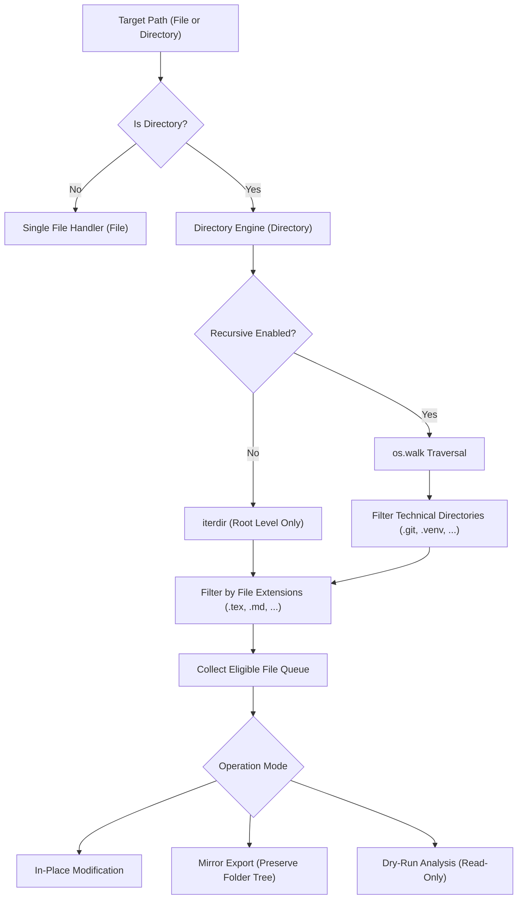
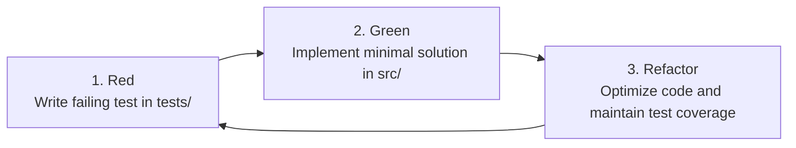

# Delete Citations

[](file:///home/newe/Documents/dev/python/delete_citation/pyproject.toml)
[](https://www.python.org/)
[](#quality-assurance-and-testing)
[](#quality-assurance-and-testing)
[](file:///home/newe/Documents/dev/python/delete_citation/LICENSE)
[](https://peps.python.org/pep-0008/)

Delete Citations is a Python library and command-line utility for detecting, removing, and replacing citation markers (such as `[cite 1]`, `[cite:42]`, and `[cite: 99]`) within text documents and across recursive directory structures.

---

## Table of Contents

- [Overview](#overview)
- [Architecture and Recursive Traversal](#architecture-and-recursive-traversal)
- [Supported Citation Patterns](#supported-citation-patterns)
- [Installation](#installation)
  - [Prerequisites](#prerequisites)
  - [Standard Installation](#standard-installation)
  - [Development Installation](#development-installation)
- [Command-Line Interface](#command-line-interface)
  - [Syntax](#syntax)
  - [Arguments and Options](#arguments-and-options)
  - [Usage Examples](#usage-examples)
- [Python API Reference](#python-api-reference)
  - [Directory Processing](#directory-processing)
  - [Single File Processing](#single-file-processing)
  - [String Transformation Functions](#string-transformation-functions)
  - [Data Models](#data-models)
- [Technical Specifications](#technical-specifications)
- [Quality Assurance and Testing](#quality-assurance-and-testing)
- [Project Structure](#project-structure)
- [Contribution Guidelines](#contribution-guidelines)
- [License](#license)

---

## Overview

Text processing workflows, document converters, collaborative editors, and machine-assisted writing pipelines often introduce numerical citation markers into plain text or markup sources. Manual cleanup of these tags is error-prone, carrying the risk of corrupting valid brackets such as array indices, mathematical expressions, or Markdown hyperlink syntax.

Delete Citations provides deterministic, regex-governed citation parsing. The tool is designed to operate seamlessly both on individual files and across deeply nested multi-file repositories, including LaTeX manuscript structures, Markdown knowledge vaults, Org-mode notebooks, and technical documentation trees.

---

## Architecture and Recursive Traversal

The core design of Delete Citations integrates directory recursion as a native operational mode rather than an external wrapper.



### Traversal Semantics
- **Directory Tree Traversal**: Enabled by default (`recursive=True`). The engine walks the complete directory hierarchy starting at the specified root.
- **Top-Level Isolation**: Can be constrained to the root directory using `--no-recursive` when nested subfolders should remain untouched.
- **Directory Pruning**: Automatically prunes standard technical and environment directories (`.git`, `.venv`, `__pycache__`, `node_modules`, etc.) before traversal to optimize performance and prevent corrupted builds.
- **Extension Filtering**: Matches target files against an explicit list of extensions or defaults to standard document types (`.tex`, `.org`, `.md`, `.txt`, `.typ`, `.rmd`, `.rst`, `.bib`, `.html`, `.xml`, `.asciidoc`, `.adoc`).
- **Mirror Hierarchy Export**: When a destination folder is supplied (`--output`), the engine mirrors the entire relative folder structure into the destination directory without modifying source files. Unmodified files within the filtered set are copied to guarantee a complete destination tree.
- **Non-Destructive Simulation**: A dry-run engine executes complete parsing and reporting pipelines without performing write operations to disk.

---

## Supported Citation Patterns

The engine uses the default pattern `\[cite:?\s*[0-9]+\]` to capture numerical citation tokens:

| Pattern Variant | Sample Input | Parsed Output (Removal) | Status |
| :--- | :--- | :--- | :--- |
| Standard whitespace | `Document [cite 1] text` | `Document  text` | Supported |
| Compact syntax | `Document [cite1] text` | `Document  text` | Supported |
| Colon separator | `Document [cite:1] text` | `Document  text` | Supported |
| Colon with whitespace | `Document [cite: 42] text` | `Document  text` | Supported |
| Large integer | `Document [cite 987654] text` | `Document  text` | Supported |

### Integrity Safeguards (Negative Matches)

The pattern is strictly bounded to prevent false positives:
- Bracketed indices (`[0]`, `[12]`) are preserved.
- Non-numerical tags (`[cite]`, `[cite ]`, `[cite author]`) are ignored.
- Markdown links (`[Anchor](https://example.com)`) remain intact.
- Parenthetical references (`(cite 1)`) are ignored.

---

## Installation

### Prerequisites
- Python 3.10 or higher.

### Standard Installation

Install directly from the local repository directory:

```bash
pip install .
```

This installs the library and registers the `delete-citations` executable in your environment.

### Development Installation

To install editable dependencies including the test framework:

```bash
git clone https://github.com/votre-nom/delete_citation.git
cd delete_citation
python3 -m venv .venv
source .venv/bin/activate
pip install -e ".[dev]"
```

---

## Command-Line Interface

### Syntax

```bash
delete-citations [OPTIONS] CHEMIN
```

### Arguments and Options

| Argument / Option | Short | Type | Default | Description |
| :--- | :---: | :---: | :---: | :--- |
| `CHEMIN` | — | Path | Required | Target file or directory to process. |
| `--output` | `-o` | Path | `None` | Output destination path. Defaults to in-place replacement. |
| `--recursive` | `-r` | Flag | `True` | Recursively traverse subdirectories. |
| `--no-recursive` | — | Flag | `False` | Restrict processing to the immediate directory only. |
| `--extension`, `--ext` | `-e` | List | Standard set | Target file extension filter (e.g., `-e .tex .md`). |
| `--all` | `-a` | Flag | `False` | Process all files without filtering by extension. |
| `--dry-run` | `-n` | Flag | `False` | Simulate the execution without writing changes to disk. |
| `--replace` | — | String | `""` | Replacement string to insert in place of removed citations. |
| `--pattern` | `-p` | String | Default regex | Custom regular expression pattern. |
| `--verbose` | `-v` | Flag | `False` | Output file-by-file diagnostic reports. |
| `--quiet` | `-q` | Flag | `False` | Suppress all standard output; return errors only. |
| `--version` | — | Flag | — | Print application version and exit. |
| `--help` | `-h` | Flag | — | Display usage instructions and exit. |

### Usage Examples

#### Single File In-Place Processing
```bash
delete-citations document.tex
```

#### Single File Export
```bash
delete-citations document.tex -o document_cleaned.tex
```

#### Recursive Directory Traversal (In-Place)
```bash
delete-citations ./manuscript/
```

#### Non-Destructive Mirror Export
Recursively cleans all eligible files and duplicates the directory hierarchy into `./manuscript_clean/`:
```bash
delete-citations ./manuscript/ -o ./manuscript_clean/
```

#### Non-Recursive Top-Level Processing
Process only files located at the root of the folder, ignoring subdirectories:
```bash
delete-citations ./manuscript/ --no-recursive
```

#### Extension Filtering
Limit processing to specific file formats:
```bash
delete-citations ./manuscript/ -e .tex .org
```

#### Dry-Run Analysis
Perform a diagnostic run to evaluate modifications without applying file system writes:
```bash
delete-citations ./manuscript/ --dry-run --verbose
```

#### Token Substitution
Replace tags with a placeholder token instead of deleting them:
```bash
delete-citations ./manuscript/ --replace "[CITATION]"
```

---

## Python API Reference

Delete Citations exposes a typed public API from the root module:

```python
from delete_citations import (
    Directory,
    File,
    detect_citations,
    remove_citations,
    replace_citations,
    BatchResult,
    FileReport,
)
```

### Directory Processing

The [`Directory`](file:///home/newe/Documents/dev/python/delete_citation/src/delete_citations/directory.py#L66-L239) class manages file discovery, hierarchy traversal, and batch transformation:

```python
from pathlib import Path
from delete_citations import Directory

# Initialize directory controller
manager = Directory(
    chemin=Path("./manuscript"),
    extensions=[".tex", ".md"],
    recursive=True,
)

# Discover matching files according to rules
files = manager.collect_files()

# Scan without modifying
detections = manager.detection()

# Execute batch removal in-place
result = manager.suppression()
print(f"Scanned: {result.total_files_scanned}")
print(f"Modified: {result.total_files_modified}")
print(f"Removed: {result.total_citations_removed}")

# Alternatively, export to a mirrored destination
# manager.suppression(destination="./output_tree")

# Or execute substitutions
# manager.remplacer(replacement="[REF]")
```

### Single File Processing

The [`File`](file:///home/newe/Documents/dev/python/delete_citation/src/delete_citations/file/file.py#L12-L60) class provides atomic operations on individual documents:

```python
from delete_citations import File

doc = File("chapter1.tex")

# Detect citations
found_citations = doc.detection()

# Remove citations in memory
doc.suppression()

# Persist to disk (in-place or to a target path)
doc.sauvegarde("chapter1_clean.tex")
```

### String Transformation Functions

Pure functions operate directly on strings without filesystem interaction:

```python
from delete_citations import detect_citations, remove_citations, replace_citations

raw_text = "Analysis [cite 1] indicates stability [cite:42]."

# Detection
tags = detect_citations(raw_text)
# Output: ['[cite 1]', '[cite:42]']

# Removal
cleaned = remove_citations(raw_text)
# Output: 'Analysis  indicates stability .'

# Replacement
substituted = replace_citations(raw_text, replacement="(ref)")
# Output: 'Analysis (ref) indicates stability (ref).'
```

### Data Models

#### [`FileReport`](file:///home/newe/Documents/dev/python/delete_citation/src/delete_citations/directory.py#L46-L54)
```python
@dataclass
class FileReport:
    source_path: Path
    output_path: Optional[Path] = None
    citations_count: int = 0
    modified: bool = False
    error: Optional[str] = None
```

#### [`BatchResult`](file:///home/newe/Documents/dev/python/delete_citation/src/delete_citations/directory.py#L56-L64)
```python
@dataclass
class BatchResult:
    total_files_scanned: int = 0
    total_files_modified: int = 0
    total_citations_removed: int = 0
    file_reports: List[FileReport] = field(default_factory=list)
    errors: List[str] = field(default_factory=list)
```

---

## Technical Specifications

### Default File Extensions
When no explicit extension filter is provided, the engine targets:
- `.tex`
- `.org`
- `.md`, `.markdown`
- `.txt`
- `.typ`
- `.rmd`
- `.rst`
- `.bib`
- `.html`
- `.xml`
- `.asciidoc`, `.adoc`

### Default Excluded Directories
To prevent unintentional modification of build artifacts and version control structures, the following directories are automatically excluded from recursive traversal:
- `.git`, `.svn`, `.hg`
- `.venv`, `venv`, `env`
- `__pycache__`, `.pytest_cache`, `.mypy_cache`, `.tox`
- `node_modules`
- `dist`, `build`, `.egg-info`
- Any directory beginning with a period (`.`)

---

## Quality Assurance and Testing

The test suite validates pattern matching, file I/O safety, directory traversal semantics, and CLI behaviors using `pytest` and `pytest-cov`.

### Executing Tests

```bash
# Run complete test suite
pytest

# Generate coverage analysis
pytest --cov=delete_citations --cov-report=term-missing
```

### Coverage Report

```text
Name                                Stmts   Miss Branch BrPart  Cover   Missing
-------------------------------------------------------------------------------
src/delete_citations/__init__.py        4      0      0      0   100%
src/delete_citations/cleaner.py         9      0      0      0   100%
src/delete_citations/directory.py     108      1     38      1    99%   97
src/delete_citations/file/file.py      31      0      2      0   100%
src/delete_citations/main.py           69      2     34      3    95%   133->135, 180, 185
-------------------------------------------------------------------------------
TOTAL                                 221      3     74      4    98%
```

- Total Tests: 64 passed
- Coverage Rate: 98%
- Target Environments: Python 3.10, 3.11, 3.12, 3.13, 3.14

---

## Project Structure

The project complies with the canonical Python `src` layout:

```text
delete_citation/
├── LICENSE
├── pyproject.toml
├── requirements.txt
├── README.md
├── src/
│   └── delete_citations/
│       ├── __init__.py
│       ├── cleaner.py
│       ├── directory.py
│       ├── main.py
│       └── file/
│           ├── __init__.py
│           └── file.py
└── tests/
    ├── conftest.py
    ├── test_cleaner.py
    ├── test_directory.py
    ├── test_file.py
    └── test_main.py
```

- [`cleaner.py`](file:///home/newe/Documents/dev/python/delete_citation/src/delete_citations/cleaner.py): Regular expression matching and pure string transforms.
- [`directory.py`](file:///home/newe/Documents/dev/python/delete_citation/src/delete_citations/directory.py): Filesystem collection, recursive directory processing, batch reporting.
- [`file.py`](file:///home/newe/Documents/dev/python/delete_citation/src/delete_citations/file/file.py): Atomic file reading, replacement, and writing.
- [`main.py`](file:///home/newe/Documents/dev/python/delete_citation/src/delete_citations/main.py): CLI interface parsing and exit code handling.

---

## Contribution Guidelines

The project enforces Test-Driven Development (TDD) for bug fixes and feature development.



### Development Rules
1. Create a descriptive feature branch: `git checkout -b feature/issue-reference`.
2. Write unit tests reproducing defects or specifying new capabilities prior to implementation.
3. Verify test failure (`pytest`).
4. Implement minimal functional code under `src/delete_citations/`.
5. Ensure all 64 existing tests pass with zero regressions and coverage remains >= 95%.
6. Submit a Pull Request with complete technical justification.

---

## License

This project is licensed under the [MIT License](file:///home/newe/Documents/dev/python/delete_citation/LICENSE).
