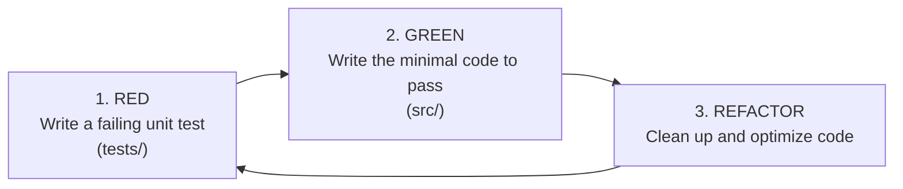

# 🧹 Delete Citations (`delete-citations`)

[](pyproject.toml)
[](https://www.python.org/)
[](#-testing-and-code-quality)
[](#-testing-and-code-quality)
[](LICENSE)
[](https://peps.python.org/pep-0008/)

**Delete Citations** is a modern, lightweight, fast, and ultra-reliable Python utility designed to **automatically detect, remove, or replace citation tags** (such as `[cite 1]`, `[cite:42]`, `[cite: 99]`) within standalone text documents or **recursively across entire directory trees**.

Whether you are managing a multi-file **LaTeX** thesis project, an **Obsidian / Markdown** note vault, **Org-mode** documents, or plain text files, this tool lets you clean up your writing instantly, either via its **Command-Line Interface (CLI)** or through its **typed Python API**.

---

## 📑 Table of Contents

- [Why this project?](#-why-this-project)
- [Key Features](#-key-features)
- [What's New in Version 0.2.0](#-whats-new-in-version-020)
- [Supported Citation Formats](#-supported-citation-formats)
- [Installation](#-installation)
  - [Prerequisites](#prerequisites)
  - [Standard Installation](#standard-installation)
  - [Development Installation](#development-installation)
- [Command-Line Interface (CLI) Guide](#-command-line-interface-cli-guide)
  - [1. Single File Processing](#1-single-file-processing)
  - [2. Recursive Directory Processing](#2-recursive-directory-processing)
  - [3. Extension Filtering](#3-extension-filtering)
  - [4. Dry-Run Mode (`--dry-run`)](#4-dry-run-mode---dry-run)
  - [5. Custom Replacement (`--replace`)](#5-custom-replacement---replace)
  - [6. Verbose and Quiet Modes](#6-verbose-and-quiet-modes)
  - [CLI Options Summary](#cli-options-summary)
- [Python API Usage Guide](#-python-api-usage-guide)
  - [1. Recursive Directory Management with `Directory`](#1-recursive-directory-management-with-directory)
  - [2. File Manipulation with `File`](#2-file-manipulation-with-file)
  - [3. Pure Functions with `cleaner`](#3-pure-functions-with-cleaner)
- [Testing and Code Quality](#-testing-and-code-quality)
- [Project Structure](#-project-structure)
- [Contribution Guide and TDD Workflow](#-contribution-guide-and-tdd-workflow)
- [License](#-license)

---

## 🎯 Why this project?

Certain text editors, research platforms, document converters, and AI assistants insert raw citation markers like `[cite 1]`, `[cite: 2]`, etc.

Cleaning up these tags manually across research papers or large-scale writing projects with dozens of subfiles (`chapters/`, `appendices/`, `notes/`) is:
1. **Extremely time-consuming** and repetitive.
2. **Risky**: manual find-and-replace can easily break legitimate brackets (e.g., array indices like `array[0]`, mathematical equations, or Markdown links `[text](url)`).

**Delete Citations** automates this cleanup with high precision using a targeted regular expression that preserves all other bracket styles, while supporting lightning-fast recursive directory processing.

---

## ✨ Key Features

- 🌳 **Recursive Directory Processing**: Automatically traverses entire subfolder trees.
- 🔍 **Targeted Detection**: Identifies only numerical citation tags without interfering with legitimate brackets (`[0]`, `[note]`, links, source code).
- 🛡️ **Data Safety & Mirror Export**: Modify files in place (*in-place*) or export the fully cleaned hierarchy to a separate output directory (`-o / --output`), leaving original files untouched.
- ⚡ **Safe Dry-Run Mode (`--dry-run`)**: Preview exact numbers of modified files and detected citations without modifying any file on disk.
- 🎯 **Smart Filtering**: Built-in support for common text and document formats (`.tex`, `.org`, `.md`, `.txt`, `.typ`, `.rmd`, `.rst`, `.bib`), with options to specify custom extensions (`-e`).
- 🛑 **Automatic Technical Folder Exclusion**: Automatically skips `.git`, `.venv`, `__pycache__`, `node_modules`, and other temporary/build directories.
- 🔄 **Custom Replacement**: Delete tags cleanly or replace them with a marker of your choice (e.g., `[CITATION]` or `(source)`).
- 🐍 **Comprehensive & Typed Python API**: `Directory` and `File` classes, pure utility functions, and structured result dataclasses (`BatchResult`, `FileReport`).
- 🧪 **Production Quality**: 64 automated tests, **98%** test coverage, strict typing.

---

## 🚀 What's New in Version 0.2.0

- ✨ **Full Directory Support**: Pass directories directly to `delete-citations`.
- 🔁 **Automatic Recursive Traversal**: Process entire directory trees in a single command (can be disabled with `--no-recursive`).
- 🪞 **Mirror Export**: When `-o <folder>` is specified, the full directory structure is mirrored with cleaned files, leaving source files unchanged.
- 🔬 **Dry-Run Simulation Mode `--dry-run` / `-n`**: Preview changes before modifying anything.
- 🏷️ **Extension Filters `-e` / `--extension`** and global processing mode `-a / --all`.
- 📊 **New `Directory` Class** integrated into the Python API.

---

## 🔎 Supported Citation Formats

The default regular expression (`\[cite:?\s*[0-9]+\]`) supports a wide variety of common citation notations:

| Citation Format | Example | Detected & Cleaned? |
| :--- | :--- | :---: |
| Standard format with space | `[cite 1]` | Yes |
| Compact format without space | `[cite1]` | Yes |
| Org-mode format with colon | `[cite:1]` | Yes |
| Format with colon and space | `[cite: 42]` | Yes |
| Multi-digit numbers | `[cite 123456]` | Yes |

### 🛡️ False-Positive Protection
The following patterns are **never touched**:
- `[12]` *(array indices, vectors)*
- `[cite]` or `[cite ]` *(incomplete tags without numbers)*
- `[cite article]` *(citations with textual identifiers outside the target pattern)*
- `[Title](link.md)` *(Markdown links)*
- `(cite 1)` *(standard parentheses)*

---

## 📦 Installation

### Prerequisites
- **Python 3.10** or higher.

### Standard Installation

From the root directory of the cloned repository:

```bash
pip install .
```

The `delete-citations` CLI tool is immediately ready to use in your environment.

### Development Installation

To work on the codebase, run tests, or contribute:

```bash
# 1. Clone the repository
git clone https://github.com/votre-nom/delete_citation.git
cd delete_citation

# 2. Create and activate a virtual environment
python3 -m venv .venv
source .venv/bin/activate    # Linux / macOS
# or: .venv\Scripts\activate # Windows

# 3. Install in editable mode with development dependencies
pip install -e ".[dev]"
```

---

## 📖 Command-Line Interface (CLI) Guide

### 1. Single File Processing

#### In-place cleanup
```bash
delete-citations document.tex
```
*Output:*
```text
3 citation(s) détectée(s).
Fichier sauvegardé avec succès dans : document.tex
```

#### Save to a new file
```bash
delete-citations document.tex -o document_cleaned.tex
```

---

### 2. Recursive Directory Processing

You can pass any folder containing your project files:

#### In-place cleanup across the whole directory tree
```bash
delete-citations ./my_project/
```
*Output:*
```text
Traitement terminé : 18 fichier(s) analysé(s), 6 modifié(s), 24 citation(s) supprimée(s).
```

#### Export to a new mirror directory (leaving source untouched)
```bash
delete-citations ./my_project/ -o ./my_project_cleaned/
```
*The full subfolder structure is replicated in `my_project_cleaned/` with cleaned files.*

#### Disable recursion (top-level directory only)
```bash
delete-citations ./my_project/ --no-recursive
```

---

### 3. Extension Filtering

By default, `delete-citations` scans common academic and text document formats (`.tex`, `.org`, `.md`, `.txt`, `.typ`, `.rmd`, `.rst`, `.bib`, etc.).

#### Specify one or more target extensions
```bash
# Process only LaTeX files
delete-citations ./my_project/ -e .tex

# Process Org-mode and Markdown files
delete-citations ./my_project/ -e .org .md
```

#### Process all files without extension filtering
```bash
delete-citations ./my_project/ --all
```

---

### 4. Dry-Run Mode (`--dry-run`)

Preview what the command will do without modifying any file on disk:

```bash
delete-citations ./my_project/ --dry-run
```
*Output:*
```text
[Simulation] Traitement terminé : 18 fichier(s) analysé(s), 6 modifié(s), 24 citation(s) supprimée(s).
```

---

### 5. Custom Replacement (`--replace`)

Instead of deleting citation tags, substitute them with a custom replacement string:

```bash
delete-citations ./my_project/ --replace "[REF]"
```

---

### 6. Verbose and Quiet Modes

- **Detailed file-by-file reporting (`-v` / `--verbose`)**:
  ```bash
  delete-citations ./my_project/ -v
  ```
  *Shows the status for each file (`[MODIFIÉ]`, `[INTACT]`, `[ERREUR]`).*

- **Quiet mode (`-q` / `--quiet`)**:
  ```bash
  delete-citations ./my_project/ -q
  ```
  *Hides all informational messages and only outputs critical errors.*

---

### CLI Options Summary

| Option | Shortcut | Description |
| :--- | :---: | :--- |
| `CHEMIN` / `PATH` | — | Target file or directory to process *(required)* |
| `--output` | `-o` | Destination file or directory |
| `--recursive` | `-r` | Recursively traverse subdirectories *(enabled by default)* |
| `--no-recursive`| — | Disable recursive directory traversal |
| `--extension` | `-e` | Filter files by extension (e.g., `-e .tex .md`) |
| `--all` | `-a` | Process all files without filtering by extension |
| `--dry-run` | `-n` | Dry-run mode (no writes to disk) |
| `--replace` | — | Replacement text for citations |
| `--pattern` | `-p` | Custom regular expression pattern to detect citations |
| `--verbose` | `-v` | Display detailed report for each processed file |
| `--quiet` | `-q` | Quiet mode (display errors only) |
| `--version` | — | Display version number |
| `--help` | `-h` | Display help message and exit |

---

## 🐍 Python API Usage Guide

The `delete_citations` package integrates smoothly into custom scripts and automated data pipelines.

### 1. Recursive Directory Management with `Directory`

```python
from delete_citations import Directory

# 1. Initialize directory manager
directory = Directory(
    "my_project/",
    extensions=[".tex", ".md"],  # Optional: filter by extension
    recursive=True               # Optional: enabled by default
)

# 2. Collect matching files
files = directory.collect_files()
print(f"{len(files)} file(s) found.")

# 3. Detect citations without modifying files
citations = directory.detection()
for path, citation_list in citations.items():
    print(f"{path.name}: {len(citation_list)} citation(s)")

# 4. Remove citations in-place
report = directory.suppression()
print(f"Modified: {report.total_files_modified}, Citations removed: {report.total_citations_removed}")

# 5. Or export to a mirrored destination directory:
# directory.suppression(destination="my_clean_project/")

# 6. Or substitute with a custom placeholder:
# directory.remplacer(replacement="[REF]")
```

### 2. File Manipulation with `File`

```python
from delete_citations import File

doc = File("chapter1.tex")

# Detect
citations = doc.detection()
print(citations)  # e.g.: ['[cite 1]', '[cite:2]']

# Remove
doc.suppression()

# Save (in-place or to a new destination)
doc.sauvegarde("chapter1_clean.tex")
```

### 3. Pure Functions with `cleaner`

```python
from delete_citations import detect_citations, remove_citations, replace_citations

text = "The experiment [cite 1] confirms the hypothesis [cite:42]."

# Detection
print(detect_citations(text))
# -> ['[cite 1]', '[cite:42]']

# Removal
print(remove_citations(text))
# -> "The experiment  confirms the hypothesis ."

# Replacement
print(replace_citations(text, replacement="(ref)"))
# -> "The experiment (ref) confirms the hypothesis (ref)."
```

---

## 🧪 Testing and Code Quality

The project adheres to strict testing standards using **`pytest`** and **`pytest-cov`**.

```bash
# Run all tests with verbose output
pytest -v

# Check code coverage
pytest --cov=delete_citations --cov-report=term-missing
```

### Test Suite Results

```text
============================== 64 passed in 0.16s ==============================

Name                                Stmts   Miss Branch BrPart  Cover   Missing
-------------------------------------------------------------------------------
src/delete_citations/__init__.py        4      0      0      0   100%
src/delete_citations/cleaner.py         9      0      0      0   100%
src/delete_citations/directory.py     108      1     38      1    99%
src/delete_citations/file/file.py      31      0      2      0   100%
src/delete_citations/main.py           69      2     34      3    95%
-------------------------------------------------------------------------------
TOTAL                                 221      3     74      4    98%
```

---

## 📁 Project Structure

The codebase strictly follows the modern Python `src-layout` standard:

```text
delete_citation/
├── LICENSE                         # MIT Open Source License
├── pyproject.toml                  # Metadata, packaging, scripts, and pytest configuration
├── requirements.txt                # Development dependencies
├── README.md                       # Comprehensive documentation
├── src/
│   └── delete_citations/
│       ├── __init__.py             # Public API entry point
│       ├── cleaner.py              # Pure logic: regex, detection, removal, replacement
│       ├── directory.py            # Directory class: recursive traversal, filtering, and batch processing
│       ├── main.py                 # CLI entry point for delete-citations
│       └── file/
│           ├── __init__.py
│           └── file.py             # File class: single file handling and I/O
└── tests/
    ├── conftest.py                 # Pytest fixtures and temporary environment setup
    ├── test_cleaner.py             # Unit tests for regex and string transformations
    ├── test_directory.py           # Integration tests for recursive directory processing
    ├── test_file.py                # Unit and I/O tests for the File class
    └── test_main.py                # End-to-end CLI functional tests (arguments, options, exit codes)
```

---

## 🤝 Contribution Guide and TDD Workflow

Contributions, bug reports, and feature requests are very welcome!

The project strictly follows the **TDD (Test-Driven Development)** cycle:



1. **Create a branch** for your feature or bugfix: `git checkout -b feature/my-feature`.
2. **Write the test first** in `tests/`.
3. **Verify the test fails** with `pytest`.
4. **Implement the code** under `src/delete_citations/`.
5. **Verify that all tests pass** (**64/64**) and that coverage remains above 95%.
6. **Open a Pull Request**.

---

## 📄 License

This project is licensed under the terms of the [MIT License](file:///home/newe/Documents/dev/python/delete_citation/LICENSE). You are free to use, modify, and distribute it without restriction.
