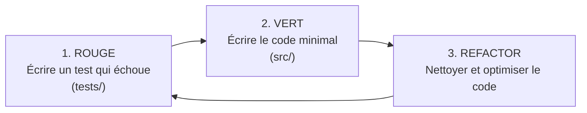

# 🧹 Delete Citations (`delete-citations`)

[](https://www.python.org/)
[](#-tests-et-qualité-du-code)
[](#-tests-et-qualité-du-code)
[](https://peps.python.org/pep-0008/)

**Delete Citations** est un utilitaire Python léger, rapide et fiable conçu pour détecter, nettoyer ou remplacer automatiquement les balises de citations (telles que `[cite 1]`, `[cite:42]`, `[cite: 99]`) dans des documents textuels.

Que vous travailliez avec du **LaTeX** (`.tex`), de l'**Org-mode** (`.org`), du **Markdown** (`.md`) ou du **texte brut**, cet outil vous permet de purifier vos écrits en un clin d'œil, soit directement en **ligne de commande (CLI)**, soit au sein de vos propres **scripts Python**.

---

## 📑 Sommaire

- [Pourquoi ce projet ?](#-pourquoi-ce-projet-)
- [Fonctionnalités principales](#-fonctionnalités-principales)
- [Formats de citations reconnus](#-formats-de-citations-reconnus)
- [Installation](#-installation)
  - [Prérequis](#prérequis)
  - [Option A : Installation utilisateur standard](#option-a--installation-utilisateur-standard)
  - [Option B : Installation pour le développement](#option-b--installation-pour-le-développement)
- [Guide d'utilisation](#-guide-dutilisation)
  - [1. Utilisation en Ligne de Commande (CLI)](#1-utilisation-en-ligne-de-commande-cli)
  - [2. Utilisation en tant que Bibliothèque Python](#2-utilisation-en-tant-que-bibliothèque-python)
- [Tests et Qualité du code](#-tests-et-qualité-du-code)
- [Structure du Projet](#-structure-du-projet)
- [Guide de Contribution et Méthode TDD](#-guide-de-contribution-et-méthode-tdd)
- [Licence](#-licence)

---

## 🎯 Pourquoi ce projet ?

Certains éditeurs de texte, plateformes de recherche, convertisseurs de documents ou modèles d'IA insèrent des annotations de citations au format brut `[cite 1]`, `[cite: 2]`, etc. 

Supprimer manuellement ces dizaines de balises dans un document de recherche de 50 pages est une tâche fastidieuse, répétitive et sujette à l'erreur (risque d'effacer par mégarde de vrais crochets comme des indices de tableaux `[0]` ou des liens Markdown). 

**Delete Citations** automatise ce nettoyage avec précision grâce à une expression régulière ciblée, sans endommager le reste de vos documents.

---

## ✨ Fonctionnalités principales

- 🔍 **Détection ciblée** : Identifie les balises de citations numériques sans interférer avec vos crochets normaux (`[12]`, `[texte]`, liens, etc.).
- 💻 **Interface en Ligne de Commande (CLI)** : Une commande unique `delete-citations` prête à l'emploi.
- 🛡️ **Sécurité des données** : Écrase le fichier d'origine ou exporte le résultat dans un nouveau fichier (`-o` / `--output`).
- 🐍 **API Python claire et typée** : Une classe `File` pour manipuler facilement vos fichiers et des fonctions pures (`detect_citations`, `remove_citations`, `replace_citations`).
- ⚡ **Remplacement personnalisé** : Possibilité de supprimer la balise ou de la substituer par un texte ou placeholder de votre choix.
- 🧪 **Testé et robuste** : Suite de tests complète (31 tests unitaires et d'intégration) avec une couverture de code supérieure à 95 %.

---

## 🔎 Formats de citations reconnus

L'expression régulière par défaut (`\[cite:?\s*[0-9]+\]`) prend en charge une large variété de notations courantes :

| Format de citation | Exemple | Détecté & Supprimé ? |
| :--- | :--- | :---: |
| Format classique avec espace | `[cite 1]` |  Oui |
| Format compact sans espace | `[cite1]` |  Oui |
| Format avec deux-points | `[cite:1]` |  Oui |
| Format avec deux-points et espace | `[cite: 42]` |  Oui |
| Nombres à plusieurs chiffres | `[cite 12345]` |  Oui |

### 🛡️ Préservation des faux-positifs
Les éléments suivants **ne sont pas touchés** afin de préserver votre contenu :
- `[12]` *(crochets numériques standards / indices de code)*
- `[cite]` ou `[cite ]` *(balise incomplète sans identifiant)*
- `[cite article]` *(balise textuelle non prise en compte par défaut)*
- `(cite 1)` *(parenthèses classiques)*

---

## 📦 Installation

### Prérequis
- **Python 3.10** ou version supérieure installé sur votre machine.

### Option A : Installation utilisateur standard

Clonez le dépôt puis installez le paquet localement :

```bash
git clone https://github.com/votre-nom/delete_citation.git
cd delete_citation
pip install .
```

La commande `delete-citations` est alors immédiatement accessible dans votre terminal.

### Option B : Installation pour le développement

Pour modifier le code, exécuter les tests ou contribuer :

```bash
# 1. Cloner le projet
git clone https://github.com/votre-nom/delete_citation.git
cd delete_citation

# 2. Créer et activer un environnement virtuel
python3 -m venv .venv
source .venv/bin/activate    # Sur Linux / macOS
# ou : .venv\Scripts\activate # Sur Windows

# 3. Installer en mode éditable avec les dépendances de dev
pip install -e ".[dev]"
# ou alternativement : pip install -r requirements.txt
```

---

## 📖 Guide d'utilisation

### 1. Utilisation en Ligne de Commande (CLI)

Le projet fournit une commande exécutable intuitive : `delete-citations`.

#### Nettoyer un fichier sur place (in-place)
Par défaut, la commande modifie directement le fichier d'origine :
```bash
delete-citations document.tex
```
*Sortie :*
```text
3 citation(s) détectée(s).
Fichier sauvegardé avec succès dans : document.tex
```

#### Sauvegarder dans un nouveau fichier de sortie
Pour préserver votre fichier d'origine et générer une copie propre :
```bash
delete-citations document.tex -o document_propre.tex
```

#### Afficher l'aide
```bash
delete-citations --help
```

---

### 2. Utilisation en tant que Bibliothèque Python

Vous pouvez importer `delete_citations` directement dans vos scripts Python.

#### Approche Orientée Objet avec la classe `File`

Idéal pour charger, inspecter, modifier et sauvegarder un fichier en quelques lignes :

```python
from delete_citations import File

# 1. Charger le fichier
doc = File("chapitre1.tex")

# 2. Inspecter les citations présentes
citations = doc.detection()
print(f"Trouvé : {citations}")
# Exemple de sortie : ['[cite 1]', '[cite:42]']

# 3. Supprimer toutes les citations
doc.suppression()

# 4. Ou les remplacer par un marqueur personnalisé :
# doc.remplacer(replacement="[RÉFÉRENCE]")

# 5. Sauvegarder (écrase le fichier d'origine ou vers une nouvelle destination)
doc.sauvegarde("chapitre1_clean.tex")
```

#### Approche Fonctionnelle avec `cleaner`

Si vous travaillez directement sur des chaînes de caractères en mémoire :

```python
from delete_citations import detect_citations, remove_citations, replace_citations

texte = "L'algorithme A* [cite 1] optimise la recherche de chemin [cite:2]."

# Détection
print(detect_citations(texte))
# Résultat : ['[cite 1]', '[cite:2]']

# Suppression
texte_nettoye = remove_citations(texte)
print(texte_nettoye)
# Résultat : "L'algorithme A*  optimise la recherche de chemin ."

# Remplacement avec un texte personnalisé
texte_remplace = replace_citations(texte, replacement="(source)")
print(texte_remplace)
# Résultat : "L'algorithme A* (source) optimise la recherche de chemin (source)."
```

---

## 🧪 Tests et Qualité du code

Le projet applique une rigueur stricte grâce à **`pytest`** et **`pytest-cov`**.

### Exécuter la suite complète de tests
```bash
pytest
```

### Afficher les détails des tests exécutés
```bash
pytest -v
```

### Vérifier la couverture de code (Code Coverage)
```bash
pytest --cov=delete_citations --cov-report=term-missing
```

### Exécuter un module de test ciblé
```bash
pytest tests/test_cleaner.py  # Tests unitaires de la regex et du nettoyage
pytest tests/test_file.py     # Tests de la classe File (lecture, écriture)
pytest tests/test_main.py     # Tests du comportement de la CLI
```

---

## 📁 Structure du Projet

L'arborescence suit les standards modernes de packaging Python (`src-layout`) :

```text
delete_citation/
├── LICENSE                     # Licence MIT
├── pyproject.toml              # Configuration du projet, métadonnées, scripts et pytest
├── requirements.txt            # Dépendances de développement (pytest, pytest-cov)
├── README.md                   # Documentation complète du projet
├── src/
│   └── delete_citations/
│       ├── __init__.py         # Point d'exposition des classes et fonctions publiques
│       ├── cleaner.py          # Logique pure : expressions régulières et transformations
│       ├── main.py             # Point d'entrée de l'interface en ligne de commande (CLI)
│       └── file/
│           ├── __init__.py
│           └── file.py         # Classe File pour la manipulation de fichiers sur disque
└── tests/
    ├── conftest.py             # Fixtures pytest (création de fichiers temporaires isolés)
    ├── test_cleaner.py         # Tests unitaires sur les fonctions de nettoyage de chaînes
    ├── test_file.py            # Tests d'intégration sur la lecture/écriture de fichiers
    └── test_main.py            # Tests fonctionnels des arguments et flux CLI
```

---

## 🤝 Guide de Contribution et Méthode TDD

Les contributions, signalements de bugs et propositions d'améliorations sont les bienvenus !

Le projet encourage vivement la pratique du **TDD (Test-Driven Development)** :



1. **Écrivez d'abord un test** : Ajoutez le cas d'usage souhaité dans `tests/` (ex: supporter un format tel que `[cite @auteur2024]`).
2. **Exécutez `pytest`** : Constatez que le test échoue (**Rouge**).
3. **Implémentez la fonctionnalité** : Modifiez l'expression régulière ou le code dans `src/delete_citations/`.
4. **Relancez `pytest`** : Validez que tous les tests passent désormais (**Vert**).
5. **Nettoyez et commitez** : Vos modifications sont protégées contre les régressions.

---

## 📄 Licence

Ce projet est distribué sous licence MIT. Consultez le fichier [LICENSE](file:///home/newe/Documents/dev/python/delete_citation/LICENSE) pour plus de détails.
